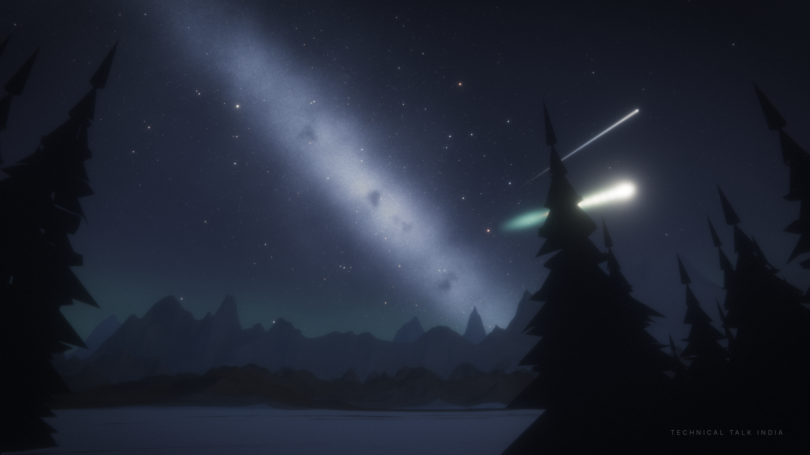

# Cinematic Meteor Shower — 15-minute video (Three.js → GitHub Actions)

A ground-level view of the night sky: a real-astronomy star field with the Milky Way and its dust lanes,
mountains, pines, airglow, satellites, ~240 meteors, 8 fireballs (with flashes, sparks, glowing trains),
3 slow earthgrazers and one "super" fireball. Everything is **procedural** — no downloaded textures, no
licensed audio. Same `config.json` + same `seed` = the exact same film every time.



## Render it on GitHub (no local setup)
1. Create a new GitHub repo and push this folder (or upload the files).
2. **Actions → "Render meteor shower video" → Run workflow**
   - `shards` = 20 (parallel jobs) · `preset` = `full` (1920×1080, 30 fps, 15:00) · `crf` = 16
   - Try `preset = preview` first (540p, ~5 min) to see the look quickly.
3. When it finishes, download the artifact **`meteor_shower_15min`** (an `.mp4` with soundtrack).

Cost/time: ≈1.8 s per 1080p frame on a 2-core machine × 27,000 frames ≈ 13.5 CPU-hours, split over
20 jobs ≈ 40–60 min wall-clock. Public repos get unlimited Actions minutes; on a private repo this
uses ~14 h of your free quota — use `shards` and the preview preset wisely.

## Run locally
```bash
npm install
export CHROME_PATH=/path/to/chrome      # or just let it fall back to @sparticuz/chromium
node render/render.mjs --still 96.4,640 --preset preview   # PNG stills in ./stills (try t=96 fireball, t=640 super fireball)
npm run preview                                            # quick low-res film in ./out-preview
npm run render && npm run audio && npm run assemble        # full render on one machine (slow)
```
Requires Node 20+, `ffmpeg` on PATH, and any Chrome/Chromium (software WebGL is fine).

## Edit the film — everything is in `config.json`
| Key | What it does |
|---|---|
| `video` | resolution, fps, duration (seconds) |
| `location`, `startTime`, `timeLapse` | observer latitude/longitude and clock — drives the real sky rotation (Milky Way, stars, radiant) |
| `radiant` | shower radiant (Orionids: RA 95°, Dec +16°); meteors streak away from it |
| `camera` | field of view, pan, and tilt (looks near the horizon first, then up at the sky) |
| `sky` | Milky Way brightness, light-pollution glow + direction, airglow |
| `meteors` | base rate, and a burst/"storm" window (`burstCenter/Width/Rate`) |
| `fireballs`, `grazers`, `satellites` | exact timing, length, brightness, flash strength |
| `overlays`, `watermark` | title cards and channel watermark text |
| `quality` | MSAA, bloom, exposure, star count, Milky Way bake size, ground light |

## How it works
- `web/shared.js` — deterministic astronomy (sidereal time → alt/az), camera path, meteor scheduler.
- `web/main.js` — Three.js scene: baked Milky Way (galactic coordinates), 15k catalog + procedural stars
  with twinkle/extinction, ribbon-shader meteors, spark particles, HDR bloom, film grain, grading.
- `render/render.mjs` — headless Chrome (SwiftShader WebGL2) renders frame *N* for time *N/fps*,
  pipes it to ffmpeg. Each shard writes independent 15-second `.mp4` segments; failed segments retry.
- `scripts/make-audio.mjs` — synthesises wind, crickets, drone, plus a panned whoosh/rumble per meteor.
- `scripts/assemble.mjs` — stitches segments losslessly and muxes the audio.

Because every frame is a pure function of its time, shards stitch together seamlessly.
